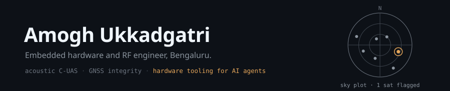

[Portfolio](https://amoghukkadgatri.vercel.app)  ·  [LinkedIn](https://www.linkedin.com/in/YOUR-LINKEDIN)  ·  amoghukkadgatri@gmail.com

## Now

**Hardware Engineer, SSS Defence.** Acoustic counter-UAS. I own the sensing hardware, from microphone arrays and capture firmware to the rigs that qualify them. I'm also on the team syncing packets, data and clocks across multiple arrays so their captures line up for joint processing. *Work is private.*

**Building [pogo-pin](https://github.com/Majorwhiskey/pogo-pin).** A hardware workbench CLI and MCP server that lets AI coding agents flash, monitor and probe ESP32 boards. v0.1.0 flashes, captures serial and decodes panics on real boards. The probe commands are waiting on probe hardware.

**Building [Tripper-Pod](https://github.com/Majorwhiskey/Tripper-Pod).** A handlebar pod for my Hunter 350 that shows Google Maps turn-by-turn directions on a round TFT. The firmware passes host tests and is waiting on the board. The Android app is in progress.

**Building [GNSS-GUARD](https://github.com/Majorwhiskey/GNSS-GUARD).** A low-cost GPS jamming and spoofing detector. The logging, feature pipeline and baseline detectors are tested on synthetic data. Real logs start once the antenna arrives, then a small int8 model goes onto the ESP32.

**Finished [Theoros](https://github.com/Majorwhiskey/gps-lora).** An encrypted GPS logger and LoRa tracker. The V1.0 board and firmware are done and ready for fabrication.

## Work

**GNSS and RF**

- [**GNSS-GUARD**](https://github.com/Majorwhiskey/GNSS-GUARD): a u-blox NEO-M8N and an ESP32 that check every second for jamming and spoofing. They watch C/N0 and AGC, clock jumps and position consistency, and measure the results against the receiver's own built-in flags. Receive-only by design.
- [**Theoros**](https://github.com/Majorwhiskey/gps-lora): a 4-layer ESP32-S3 board that logs u-blox M10 fixes to microSD and sends position over LoRa, encrypted with AES-128-CCM. Designed in KiCad for machine assembly.

**Acoustic sensing**

- [**Membrane over MEMS Port**](https://github.com/Majorwhiskey/Membrane-over-MEMS-Port-Acoustic-Simulation): a lumped-element simulator for a protective membrane over a bottom-port MEMS mic, with thermoviscous losses, leak paths and a GUI. It comes with an IEEE-style report. Main finding: resonant membranes ruin mic-to-mic phase matching, but a sealed carbon-fibre disc is acoustically transparent.
- [**3D Acoustic Localization**](https://github.com/Majorwhiskey/3-d-Acoustic-Localization-using-Microphone-array-and-AI-): finds where a sound comes from in 3D with a mic array on a Raspberry Pi, using DOA estimation and triangulation. My final-year project, and how I got into C-UAS.
- **Mic-array test rig**: qualifies custom microphone arrays over ESP32 I2S. It moves to TDM capture to get past the classic ESP32's single-RX-channel limit. *· at SSS Defence, private*

**Embedded and devices**

- [**Tripper-Pod**](https://github.com/Majorwhiskey/Tripper-Pod): an Android companion app in Kotlin reads Maps navigation and sends it over BLE to an ESP32-S3 with a round TFT. App and firmware share a versioned protocol spec and byte-exact test vectors.

**Tooling for AI agents**

- [**pogo-pin**](https://github.com/Majorwhiskey/pogo-pin): a Rust CLI (`pogo`) and MCP server for ESP32 bench work. Every command terminates, returns JSON and uses meaningful exit codes, so an agent can run edit → build → flash → read result on its own.
- [**Agent-Skills**](https://github.com/Majorwhiskey/Agent-Skills): 30+ Markdown skills for coding agents across embedded, RF, DSP, FPGA, PCB, DevOps and security. Includes a KiCad routing skill. Installs as Claude Code skills.

**Tracking and estimation**

- [**Radar Tracking & Classification**](https://github.com/Majorwhiskey/Real-time-3D-radar-tracking-and-classification-system): follows simulated radar targets through noisy measurements with Kalman and particle filters, classifies their motion with SVMs, and plots the tracks live.

## Also built

[Portfolio](https://github.com/Majorwhiskey/Portfolio), one static page with hand-coded canvas animations and no framework · [Aroodha Foundation](https://github.com/Majorwhiskey/Aroodha-Foundation), a website for a foundation's programs, events and donations · [Lab Inventory Dashboard](https://github.com/Majorwhiskey/Lab-inventory-dashboard), real-time lab inventory with search and Excel export

## Background

B.E., Electronics & Communication, KLE Institute of Technology, 2026 · Chair, KLEIT–IEEE MTT-S Chapter, 2024–25 · Vice-Chair, KLEIT–IEEE Student Branch, 2023–24 · theatre with the university cultural group

## Tools

C · C++ · Rust · Python · Kotlin · MATLAB · ESP32 / ESP32-S3 · Raspberry Pi · KiCad · LoRa · BLE · u-blox UBX · I2S / PDM / TDM audio · Kalman and particle filters · DOA estimation · TinyML · MCP · Linux

*If you work on GNSS integrity, counter-UAS or embedded RF, I'd love to talk.*
